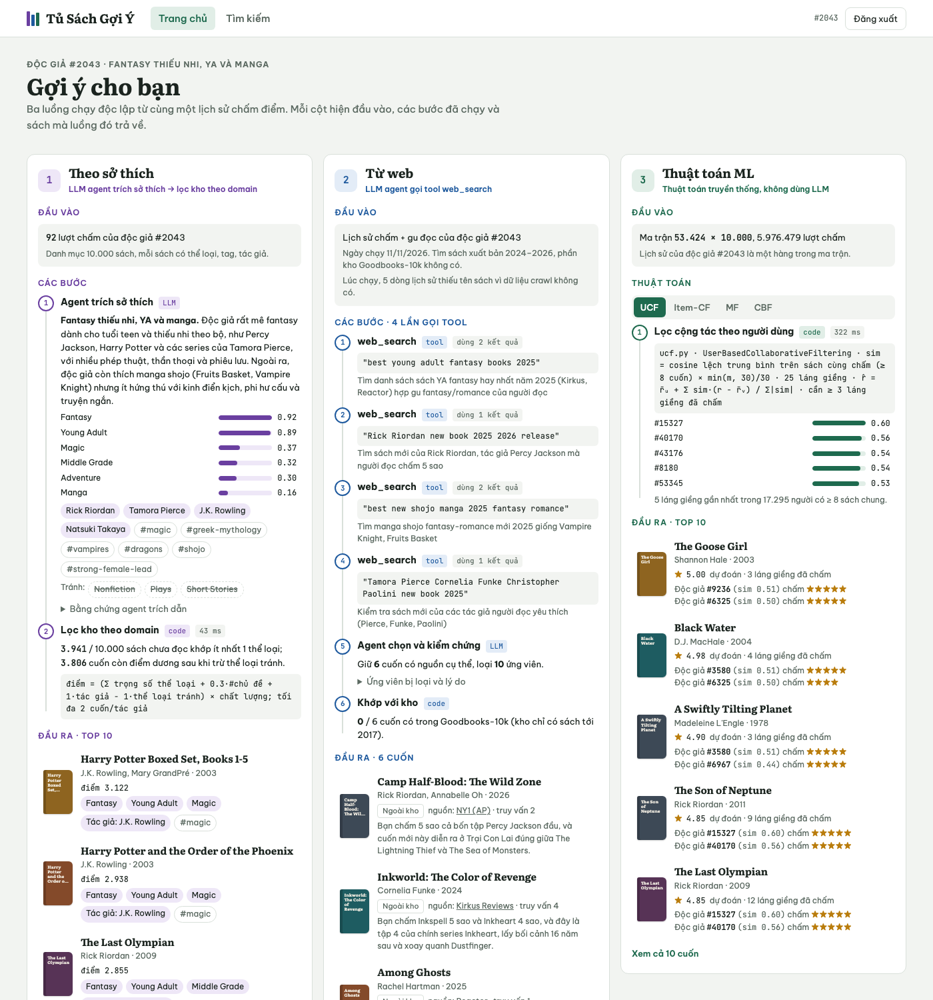
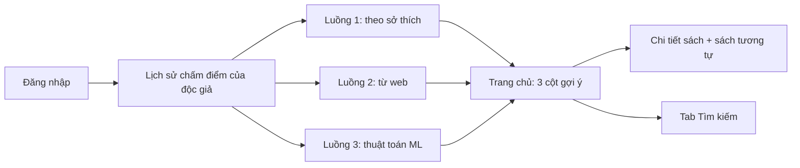

# Tủ Sách Gợi Ý: demo giao diện

Bản demo tĩnh của app gợi ý sách, giúp cả nhóm hình dung app sẽ chạy thế nào. Sau khi đăng nhập, trang chủ hiện 3 luồng gợi ý đặt cạnh nhau. Mỗi luồng cho thấy đầu vào, các bước đã chạy và sách trả về.

Demo không có backend. Mọi kết quả được tính sẵn ngày 11/11/2026 từ dữ liệu Goodbooks-10k và mô tả sách đã crawl ở thư mục gốc của repo này (`books_mapped.jsonl`, `data/*.csv`).



## Mở demo

- Cách nhanh nhất: mở file `app_demo/index.html` bằng trình duyệt. Trang chạy được mà không cần server, chỉ cần mạng để tải font.
- Hoặc chạy server tĩnh trong thư mục `app_demo/`:

  ```bash
  cd app_demo
  python3 -m http.server 8000
  ```

  rồi mở http://localhost:8000.
- Muốn chia sẻ bằng link, chủ repo bật GitHub Pages (Settings, Pages, Deploy from a branch, chọn nhánh `app_demo` và thư mục gốc). Demo khi đó nằm ở https://dinhthigaamer.github.io/Recommendation_system/app_demo/ và không cần bước build nào.

## App làm gì



| màn hình | nội dung |
|---|---|
| Đăng nhập | Chọn 1 trong 3 tài khoản demo. Mỗi tài khoản là một độc giả thật trong `ratings.csv`. |
| Trang chủ | 3 cột luồng gợi ý, phần sách trùng giữa các luồng, lịch sử chấm điểm của độc giả. |
| Tìm kiếm | Tìm theo tên sách hoặc tác giả trong các sách của bản demo, lọc theo thể loại, sắp xếp. |
| Chi tiết sách | Thông tin sách, mô tả đã crawl, 6 sách tương tự theo nội dung kèm điểm cosine. |
| Chi tiết sách từ web | Nguồn, đoạn trích từ kết quả tìm kiếm, lý do agent chọn, câu truy vấn đã dùng. |

## Ba luồng gợi ý

Ba luồng chạy độc lập từ cùng một lịch sử chấm điểm.

| luồng | cách làm | đầu ra |
|---|---|---|
| 1. Theo sở thích | LLM agent đọc lịch sử chấm và trích hồ sơ sở thích. Code dùng hồ sơ đó để lọc kho. | 10 sách trong domain của độc giả |
| 2. Từ web | LLM agent gọi tool tìm web 3 đến 4 lần để tìm sách mới hợp gu. | 6 sách xuất bản 2024–2026, có link nguồn |
| 3. Thuật toán ML | 4 thuật toán truyền thống chạy trên toàn bộ ma trận chấm điểm. Không dùng LLM. | top 10 của mỗi thuật toán |

### Luồng 1: theo sở thích

1. Agent đọc toàn bộ lịch sử chấm và trả về JSON gồm: thể loại kèm trọng số, tác giả yêu thích, chủ đề, thể loại nên tránh. Thể loại, tác giả và thể loại nên tránh đều kèm tên sách làm bằng chứng. Prompt nằm ở [`pipeline/prompts/preference-agent.md`](pipeline/prompts/preference-agent.md).
2. Code chấm điểm mọi sách chưa đọc có ít nhất 1 thể loại khớp. Điểm gồm tổng trọng số thể loại, cộng thêm khi khớp chủ đề hoặc tác giả, trừ khi dính thể loại nên tránh. Điểm này nhân với chất lượng sách, tính từ điểm trung bình và số lượt chấm.
3. Mỗi tác giả có tối đa 2 cuốn, để một series không chiếm hết danh sách.

### Luồng 2: từ web

1. Agent gọi tool tìm web với các câu truy vấn như danh sách sách hay năm 2025 hoặc sách mới của tác giả độc giả thích. Trang hiện từng câu truy vấn.
2. Agent chọn 6 cuốn có nguồn cụ thể, ghi lý do và loại các ứng viên không kiểm chứng được. Prompt nằm ở [`pipeline/prompts/web-search-agent.md`](pipeline/prompts/web-search-agent.md).
3. Code so tên sách với kho. Kho Goodbooks-10k chỉ có sách tới 2017, nên sách mới hiện nhãn "Ngoài kho".

Sau khi agent chạy, từng link nguồn được mở lại để kiểm tra. 13 trên 18 nguồn đúng hoàn toàn. 5 cuốn đã được sửa, và trang chi tiết của mỗi cuốn có ghi chú lý do sửa.

### Luồng 3: thuật toán ML

Đầu vào là ma trận 53.424 độc giả × 10.000 sách với 5.976.479 lượt chấm. Các thuật toán là bản rút gọn của `ucf.py` và `content_filtering.py` ở thư mục gốc của repo.

| thuật toán | dựa trên | cách tính trong demo |
|---|---|---|
| UCF | `ucf.py`, `UserBasedCollaborativeFiltering` | Độ tương đồng là cosine trên điểm đã trừ trung bình, chỉ tính các sách cả hai cùng chấm (ít nhất 8 cuốn), nhân `min(m, 30)/30`. Dùng 25 láng giềng; một sách cần ít nhất 3 láng giềng đã chấm. |
| Item-CF | `ucf.py`, `ItemBasedCollaborativeFiltering` | Adjusted cosine giữa các sách. Dự đoán từ 25 sách giống nhất mà độc giả đã chấm. Bỏ sách có tổng độ tương đồng dưới 0.5. |
| MF | `ucf.py`, `MatrixEmbedding` | Dùng SVD 50 yếu tố thay cho bản huấn luyện bằng SGD của repo. Giải thích bằng yếu tố đóng góp nhiều nhất. |
| CBF | `content_filtering.py` | TF-IDF trên thể loại, tác giả, tag và mô tả. Hồ sơ độc giả là trung bình có trọng số của các sách đã chấm, trọng số bằng điểm trừ điểm trung bình của họ. |

## Dữ liệu trong demo

- **3 độc giả thật.** `pipeline/prep.py` xét 3000 độc giả đầu tiên (theo `user_id`) có 90 đến 160 lượt chấm, rồi giữ người có ít nhất 20 cuốn 5 sao. Với mỗi thể loại Fantasy, Classics và Romance, script chọn người có tỉ lệ sách 5 sao thuộc thể loại đó cao nhất. Kết quả là các độc giả `#2043`, `#1029` và `#496`.
- **1.003 sách.** Gồm 120 sách nhiều lượt chấm nhất, các sách xuất hiện trong gợi ý hoặc lịch sử, và các sách tương tự của chúng. Tab Tìm kiếm chỉ tìm trong số này.
- **Bìa sách** được vẽ bằng CSS, vì demo không tải ảnh từ trang ngoài.

## Cấu trúc thư mục

Các đường dẫn dưới đây tính từ thư mục `app_demo/`.

```text
index.html                 khung trang
css/styles.css             giao diện, có cả giao diện tối
js/app.js                  điều hướng, vẽ 3 luồng, tìm kiếm, ngăn chi tiết
data/demo-data.js          dữ liệu đã tính sẵn (window.DEMO_DATA)
docs/                      ảnh chụp màn hình cho README
pipeline/
  prep.py                  tính 3 luồng và ghi data/demo-data.js
  personas.py              ghi lịch sử chấm của từng độc giả làm đầu vào cho agent
  requirements.txt         thư viện Python cho pipeline
  prompts/                 prompt của 2 agent
  agent-data/              đầu vào và đầu ra của agent
    reader_<id>.txt        lịch sử chấm của độc giả, đầu vào cho agent
    genres.txt             danh sách thể loại của kho
    prefs.json             output agent sở thích (luồng 1)
    webs.raw.json          output gốc của agent tìm web (luồng 2)
    webs.json              bản đã kiểm chứng nguồn, trang dùng bản này
```

Dữ liệu nằm trong file `.js` thay vì `.json` vì trình duyệt chặn `fetch()` khi mở trang trực tiếp từ ổ đĩa.

## Dựng lại dữ liệu

Chạy từ thư mục gốc của repo, vì script đọc `books_mapped.jsonl` và `data/*.csv` ở đó.

```bash
pip install -r app_demo/pipeline/requirements.txt
python app_demo/pipeline/prep.py . app_demo/data/demo-data.js app_demo/pipeline/agent-data
```

Lệnh `prep.py` chạy khoảng 10 giây. Nó tính lại luồng 3 và đọc output agent có sẵn trong `app_demo/pipeline/agent-data/` cho luồng 1 và 2.

Muốn chạy lại agent:

1. Ghi lại lịch sử chấm làm đầu vào:

   ```bash
   python app_demo/pipeline/personas.py . app_demo/pipeline/agent-data 2043 1029 496
   ```

2. Chạy prompt trong `app_demo/pipeline/prompts/` bằng một LLM có tool tìm web.
3. Lưu kết quả vào `prefs.json` và `webs.json`. Mỗi file là một mảng JSON gồm 3 object, mỗi độc giả một object theo schema trong file prompt.
4. Chạy lại `prep.py`.

## Giới hạn của bản demo

- Đăng nhập chỉ là chọn tài khoản demo, không có xác thực.
- Bấm đăng nhập không gọi agent hay tìm web. Kết quả của cả 3 luồng đã được tính từ trước.
- Kết quả tìm web phản ánh ngày 11/11/2026. Link nguồn có thể đổi hoặc hỏng về sau.
- Thuật toán ở luồng 3 là bản rút gọn; tham số và cách tính khác với repo được ghi ở bảng trên và trên trang.
- Khi agent tìm web chạy, lịch sử của mỗi độc giả thiếu tên 5 đến 12 cuốn do dữ liệu crawl không có. Trang có ghi rõ số này.
